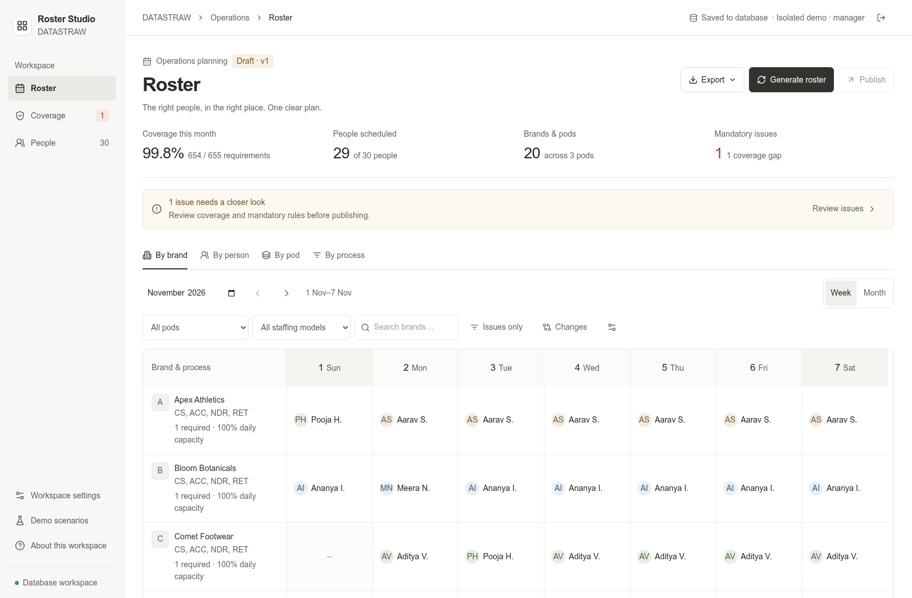

# Roster System

Monthly workforce planning for multi-brand operations: generate a roster, explain coverage gaps, handle availability changes, and publish a validated schedule.

**Built for the DATASTRAW Smart Roster Management System assessment.** The application is called _Roster Studio_ in the interface.

[Live application](https://thank-consumption-motivation-seniors.trycloudflare.com) · [Narrated demo · 3:56](https://thank-consumption-motivation-seniors.trycloudflare.com/walkthrough-narrated.mp4) · [Approach note](APPROACH.md) · [Requirement matrix](docs/ASSESSMENT_COMPLIANCE.md)

> **Access:** choose **Try the interactive demo**. No account or local setup is required. Each reviewer receives an isolated, temporary PostgreSQL-backed workspace with fictional data. The current app/video hostname is a temporary HTTPS tunnel, not permanent hosting.



## Review the application

1. **Generate:** open the demo and generate a monthly roster for 30 employees across 20 brands and three pods.
2. **Inspect:** switch between brand, person, pod and process views; compare weekly and monthly schedules.
3. **Check calendars:** inspect Services in Workspace settings to compare 365-day, holiday-excluding and Sunday-excluding operations.
4. **Change availability:** use Demo scenarios to simulate sole-primary or multi-staff leave after generation.
5. **Resolve deliberately:** review the resulting coverage gaps and eligible replacements. Mandatory blockers prevent publication; the app does not invent authorization or silently relax staffing.
6. **Configure:** edit people, brands, processes, pods/leads, eligibility, time off and service requirements without changing code.

The default November sample intentionally contains an unresolved staffing gap so conflict detection is visible. A gap is not a successful schedule: publish remains blocked until the mandatory audit passes.

## Assessment coverage

| Requirement                      | Implemented behavior                                                                                                                |
| -------------------------------- | ----------------------------------------------------------------------------------------------------------------------------------- |
| Team, brands, processes and pods | 30 fictional employees; 20 brands; three pods and leads; explicit primary/backup/relief eligibility                                 |
| Realistic staffing patterns      | 16 single-primary brands and four multi-resource brands; separate and overlapping process assignments; distinct multi-person demand |
| Client-specific working rules    | Service calendars, public holidays, date overrides, minimum staffing, individual availability and preferred offs                    |
| Monthly generation               | Actual month lengths/leap years; deterministic generation; pinned work; independent validation                                      |
| Conflict detection               | Coverage, authorization, leave, capacity, duplicate staffing, incompatible/overnight shifts and configured rest rules               |
| Stakeholder views and editing    | Company-wide roster plus brand/person/pod/process views, filters, cell inspection and manual edits                                  |
| Post-generation changes          | Availability changes revalidate affected work; safe direct repairs use explicitly eligible people only                              |
| Central database                 | PostgreSQL persistence, scoped sessions, atomic revisions and immutable publication history                                         |

See the [full assessment matrix](docs/ASSESSMENT_COMPLIANCE.md) for evidence and the distinction between required, optional and operational safeguards.

## Architecture

```text
Browser workspace
  → authenticated Next.js API: role + Origin + CSRF checks
  → PostgreSQL transaction: row lock + revision compare-and-swap
  → synchronous domain bridge: import → validate/apply → export → clear
  → roster domain adapter → reusable TypeScript scheduling engine
```

| Layer        | Stack / responsibility                                                                                   |
| ------------ | -------------------------------------------------------------------------------------------------------- |
| Interface    | React 19, Next.js 16, TypeScript, Tailwind CSS and Lucide                                                |
| Domain       | Explicit employee/service relationships, transactional commands, catalog rules and history               |
| Scheduling   | Calendar expansion, greedy candidate selection, independent hard-constraint audit and explained gaps     |
| Persistence  | PostgreSQL 17; canonical JSONB workspace aggregate, sessions, revisions and immutable publication ledger |
| Verification | Vitest, Playwright and real PostgreSQL integration tests                                                 |

The core engine uses resources, services, demand slots and allocations rather than UI-specific brand logic. A second-domain fixture exercises this separation. This is reusable scheduling infrastructure, not a claim that arbitrary new industries work without additional rules.

## Run locally

**Validated prerequisites:** Node.js 24, npm and PostgreSQL 17.

```bash
npm ci
cp .env.example .env.local
# Configure DATABASE_URL and APP_ORIGIN in .env.local.
node --env-file=.env.local scripts/roster-migrate.mjs
npm run dev
```

Open the exact `APP_ORIGIN` you configured and choose **Try the interactive demo**. Never commit `.env.local` or real credentials. Managed manager/viewer sign-in is optional for the demo; password hashing and server variables are documented in the [database/session setup guide](docs/deployment/postgresql-sessions.md).

Production uses `npm run build` followed by `npm start`; use HTTPS and a matching exact origin. See [deployment operations](docs/deployment/OPERATIONS.md).

## Tests and validation

```bash
npm run lint
npm run typecheck
npm test
npm run build
# With a ready application server and installed Chromium:
npx playwright install chromium
PLAYWRIGHT_BASE_URL=http://127.0.0.1:3000 npm run test:e2e
```

**Database safety:** real integration tests require `TEST_DATABASE_URL` pointing to a disposable database whose name includes `test` or `ci`. They truncate test tables. Never use the production database. Without that variable, database integration cases are visibly skipped. Viewer acceptance checks need the matching private test fixtures described in the setup guide.

The verified deployed release passed **213 unit/integration tests** and **27 public HTTPS browser cases**, including realistic 30-person roster publication, immutable history, actual viewer rejection and stale-write protection. Actual application/database restart and disposable backup-restore checks are recorded in [release verification](docs/RELEASE_VERIFICATION.md). These are point-in-time results, not an uptime or security certification.

This repository does **not** enable GitHub Actions. Run the commands above to reproduce verification; the recorded local/deployed results are linked separately. Automated hosted CI can be added later, but no GitHub CI pass is claimed.

## Assumptions and trade-offs

- A mandatory constraint is never silently treated as a preference. Invalid pinned work is preserved and flagged.
- A greedy result is not an optimality or infeasibility proof; unresolved coverage stays visible.
- Client operating calendars are separate from employee working schedules. Compatible process bundles are explicit, not inferred from fractional workload.
- Shift intervals and recorded previous-month history are checked; missing history is unknown, not fabricated.
- Catalog changes are active-month scoped. Safe reference checks prevent destructive cascading deletes; published snapshots remain immutable.
- The deployment has explicit bounds, including 2 MB requests, 24 month documents and 100 server publications per period. See the [technical guide](docs/TECHNICAL_GUIDE.md) for the complete limits.
- This is an assessment implementation, not labor-law, enterprise-security or accessibility certification. Stable hosting, offsite backups and broader operational hardening remain follow-up work.

## Tell Us How You Think

### 1. Employees, brands, processes, pods and relationships?

Employees belong to pods; pods have existing employee leads. Brands belong to pods. A brand/process requirement defines calendar, distinct staffing, workload and shift; compatible processes can share an explicit bundle. Eligibility authorizes employees as primary, backup or relief; actual dated allocations are separate. Central PostgreSQL persists the canonical aggregate and independently immutable publication ledger.

### 2. Generation and constraint satisfaction?

Expand calendars/holidays/overrides to dated demand, load recorded previous-month history, validate configuration and pins, order seats by initial candidate scarcity, then greedily rank eligible candidates. Independently audit the result and again on server publication. Partial output is explained, not mislabeled optimal or infeasible.

### 3. Single-resource versus multi-resource brands?

Single-primary bundles consume one configured workload and one shared shift; relief must be explicitly eligible. Multi-resource brands have distinct service requirements, including overlapping eligibility and queues requiring two distinct people. Staffing labels never override actual required counts.

### 4. Sole primary unavailable?

Approved leave removes affected unlocked work and exposes all resulting service gaps. Locked work is retained as a blocker. Eligible available capacity-compatible candidates are shown; if none can cover, the gap stays visible and publication is blocked.

### 5. Conflicting requirements or insufficient staffing?

Expose rule-specific blockers with affected date/person/service. Check both aggregate capacity and actual shift compatibility. Managers review staffing, authorization, leave or the client's requirement; the system never invents staff, removes leave or silently relaxes mandatory coverage.

### 6. Automated versus human-controlled?

Calendar/history expansion, generation, audit, coverage and ranked direct replacements are automated. Managers authorize duties, configure policies, record approved time off, inspect/pin/edit, resolve exceptions and publish. Server permissions, fresh validation and revision checks enforce those boundaries.

### 7. Doubling team and brands?

Benchmark the real workload first. The aggregate repository already provides transactions and stale-write protection. Profile repeated audit/index work, move expensive scheduling to bounded background jobs if needed, and normalize/index individual entities when query and reporting patterns justify it. Introduce a stronger solver only if measured schedule quality requires it; do not assert linear scaling or guaranteed optimality.

### 8. One additional week?

Prioritize stable domain/HTTPS hosting, offsite backup and restore drills, monitoring, stronger identity/account administration and realistic multi-user/load/security acceptance. Then improve interval-level coverage, deeper history integration, solver quality/swap search and any client-specific rest entitlements.

## Documentation

- [APPROACH.md](APPROACH.md) — solution, architecture and key decisions.
- [Assessment matrix](docs/ASSESSMENT_COMPLIANCE.md) — requirements and evidence boundaries.
- [Technical guide](docs/TECHNICAL_GUIDE.md) — constraints, limits, persistence and configuration.
- [Release verification](docs/RELEASE_VERIFICATION.md) — actual test/deployment/recovery evidence.
- [Walkthrough](docs/WALKTHROUGH.md) — chapters and video validation.
- [Submission checklist](SUBMISSION.md) — recruiter links and remaining applicant-owned items.
- [Third-party notices](THIRD_PARTY_NOTICES.md) — dependency and narration provenance.

AI-assisted development and specialist review were used transparently. Scheduling decisions are deterministic and independently validated; an LLM is not the authority for coverage or publication. Review notes and historical evidence are retained under `docs/`, rather than mixed into application code.

The optional [offline narration tools](tools/narration/README.md) generate the demo voiceover separately; no speech model or TTS service is part of the roster runtime.
